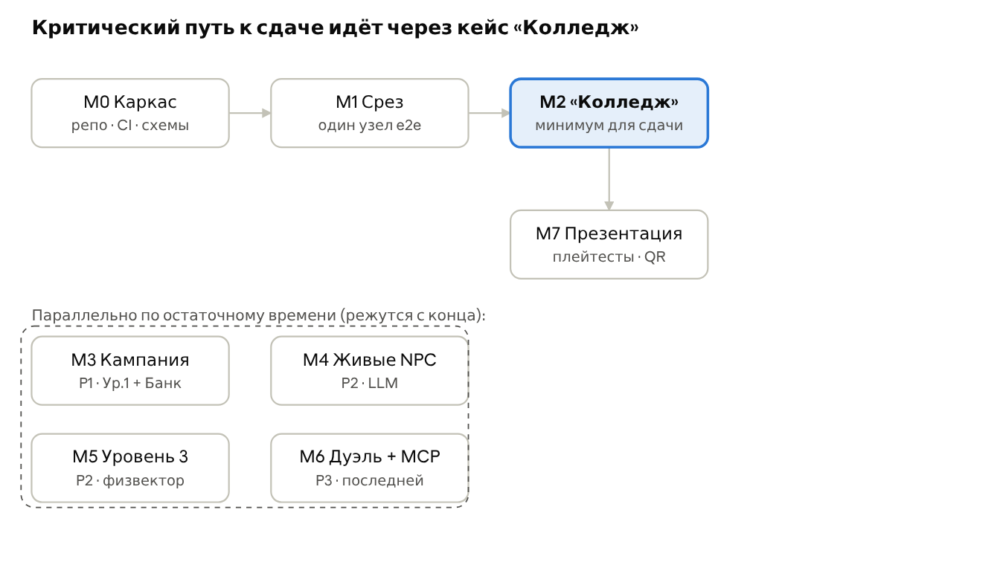

# ZERO DAY — Техническое задание

Oct 24, 2026 · @Boby

## 1. Краткий вывод и общие сведения

**Рекомендация.** ZERO DAY строится вокруг самостоятельного FastAPI-модуля `npc_api` для живых NPC. Чистый TypeScript-движок и версионируемый JSON-контент работают в браузере и офлайн. React-клиент, общий игровой API для дуэлей, MCP и телеметрия развиваются независимо от NPC API. Новый кейс = новый JSON-файл, новый NPC = YAML-профиль и строка в `chars/npc_ids.csv`.

**Что это за документ.** Техническое задание на разработку браузерной игры ZERO DAY для кейса банка «Центр-инвест» (призовой фонд 100 000 ₽). Источники: ГДД v0.2, Каталог головоломок v0.3, диздоки Уровней 1–3 v0.1, консолидированный контекст проекта, условия кейса. При расхождении приоритет у более свежего документа; старый диздок «Агрохолдинг Дон» не используется.

**Продукт.** Детективная головоломка-пентест: игрок по договору «тихо» проходит сеть вымышленной организации через два вектора — людей (социнженерия в чате) и машины (граф узлов с вымышленными уязвимостями СЛ-xx), затем закрывает дыры и пишет отчёт. Профессия — специалист по кибербезопасности / этичный пентестер.

**Аудитория.** Подростки до 16 лет, запуск по ссылке/QR, без регистрации (только никнейм).

**Жёсткие ограничения из условий кейса и дизайна**

| № | Ограничение | Следствие для разработки |
| --- | --- | --- |
| C-1 | Браузер, по ссылке, без регистрации | Анонимная сессия, никнейм хранится локально, никаких e-mail/телефонов |
| C-2 | Без критических багов | Автотесты движка, автопрохождение контента ботом, e2e на ключевые сценарии |
| C-3 | Масштабируемость | Уровень = данные; механики = подключаемые системы; головоломки = плагины |
| C-4 | Вымышлен только исполняемый слой | Нигде нет реальных команд, адресов, эксплойтов; контент-линтер это проверяет |
| C-5 | Никаких таймеров на размышление | Игровое время идёт только от действий игрока; исключение — срок жизни OTP внутри головоломки СЛ-12 |
| C-6 | Ключ LLM не в браузере | Только `npc_api`; лимиты запросов и бюджета добавляются отдельной задачей T-E3 |
| C-7 | Свой хостинг в Docker Compose | Весь стек поднимается одной командой docker compose up; на VPS перед ним стоит Caddy (TLS Let's Encrypt, reverse proxy на localhost) |

**Объём (scope) по приоритетам**

| Приоритет | Что входит | Почему так |
| --- | --- | --- |
| P0 — обязательно | Движок, сетевая карта, терминал-гипотеза, тревога, Флиппер, кейс L1C1 «Сосед» (обучающий, идёт первым), 6 головоломок кейса «Колледж», 3 NPC на сценарных ветках, двойной замок, отчёт, Кодекс, scope и развилка последствий, сохранение в localStorage | Это закрывает все обязательные критерии кейса: короткое обучение на «Соседе» и один завершённый кейс-срез «Колледж» |
| P1 — должно быть | Остаток Уровня 1 (Кейс 2 «Друг»), Кейс 2 Уровня 2 (банк), интерлюдии, ранги и профиль, мобильная раскладка, музыка и звуки | Три уровня = «несколько уровней сложности» (задача со звёздочкой) |
| P2 — желательно | Уровень 3 целиком, живая LLM в NPC с офлайн-fallback | Вау-эффект и тема ИИ |
| P3 — последним | Мультиплеер-дуэль Red vs Blue + ИИ-соперник через MCP | Самая рискованная часть; ядро от неё не зависит |
| Вне объёма | Ежедневный взлом, редактор уровней, лидерборды, аккаунты, Уровень 4 | Задел в архитектуре есть, реализация — после хакатона |

**Критерий успеха прототипа:** жюри по QR-коду открывает игру, вводит никнейм, проходит обучающий кейс «Сосед» (3–5 минут) и за 15–25 минут — кейс «Колледж» от брифа до отчёта без ошибок, понимая, чем занимается пентестер. Порядок кампании: Сосед → (Друг, P1) → интерлюдия → Колледж.

## 2. Допущения и открытые вопросы

Работа начинается на допущениях ниже; каждое можно пересмотреть без переписывания архитектуры, кроме отмеченных как «дорого менять».

**Допущения**

| № | Допущение | Цена ошибки |
| --- | --- | --- |
| A-1 | Команда 4 человека (подтверждено, Q-1), роли совмещаются: FE-1/техлид, FE-2, BE/инфра, геймдизайн+дизайн/QA. Каждый работает с ИИ-ассистентами (4 подписки Claude Code, 2 Codex), поэтому план рассчитан на высокий параллелизм задач | Средняя: меняется только план и линии отсечения |
| A-2 | Кампания — одиночная игра, состязательности и наград за читерство нет → движок исполняется на клиенте | Низкая: движок чистый, его можно перенести на Node-сервер целиком |
| A-3 | Дуэль — отдельный режим со своими упрощёнными правилами и авторитетным сервером | Средняя |
| A-4 | Основное устройство — десктоп/ноутбук от 1280×720; планшет и телефон (от 375 px) — адаптивная раскладка, потому что жюри откроет QR с телефона | Высокая, если телефон проигнорировать |
| A-5 | Язык — только русский; тексты живут в контенте и в одном файле UI-строк, не в коде | Низкая |
| A-6 | Один инстанс backend на хакатон; пик — до 200 одновременных игроков и до 20 дуэлей | Низкая: путь масштабирования описан в разделе 11 |
| A-7 | Персональные данные не собираются; телеметрия анонимна (случайный id сессии), никнейм на сервер уходит только в дуэли | Средняя (152-ФЗ, несовершеннолетние) |
| A-8 | LLM-провайдер скрыт за адаптером; основной — OpenAI-совместимый API (китайские модели, бюджет ~4 млрд токенов, Q-2) | Низкая |
| A-9 | Одна головоломка длится 30–120 секунд; кейс «Колледж» — 15–25 минут; вся кампания — 90–150 минут | Низкая |
| A-10 | «Нет таймеров» трактуется как «игровое время = счётчик действий игрока»: движение охотника Игоря, окна бдительности (СЛ-09) и патрули (СЛ-10) сдвигаются на шаг за каждое действие | Дорого менять позже: затрагивает модель времени в движке |

**Вопросы и принятые ответы (закрыты 24.10.2026)**

- ☑ Q-1. Сколько длится хакатон и каков точный состав команды? **Ответ:** длительность не ограничивает план; команда — 4 человека, у каждого ИИ-ассистент (4 подписки Claude Code, 2 Codex). Линии отсечения P1–P3 остаются как страховка.

- ☑ Q-2. Какой LLM-провайдер доступен команде? **Ответ:** OpenAI-совместимый API китайских моделей, ~4 млрд токенов. Адаптер OpenAI-совместимый — основной; tool use нужен для ИИ-соперника в дуэли (проверить у выбранной модели).

- ☑ Q-3. Где хостим демо? **Ответ:** свой VPS с доменом, HTTPS через Let's Encrypt. На хосте стоит Caddy (автоматический TLS), домен направлен на него, Caddy reverse proxy прокидывает трафик на localhost, где в Docker Compose поднят сайт. WebSocket (/ws) и MCP (/mcp) должны работать через этот прокси.

- ☑ Q-4. Репозиторий публичный? **Ответ:** да, публичный, лицензия MIT. Секреты в репозиторий не попадают никогда: только env на сервере, в репо — .env.example без значений, gitleaks в CI и pre-commit.

- ☑ Q-5. Геймдизайн дуэли. **Ответ:** правила описаны в docs/ZERO_DAY_Мультиплеер_MCP.md — он источник геймдизайна дуэли; раздел 11 — его техническая конкретизация. Открытый подвопрос Q-5a: диздок описывает раунд «в реальном времени» с мягким таймером, раздел 11 — одновременные ходы (из-за задержки LLM 2–10 с, ADR-09); выбрать до старта T-F1.

- ☑ Q-6. Как играется «лента логов» СЛ-11 и патруль СЛ-10 без таймера? **Ответ:** принято: лента прокручивается игроком и ставится на паузу, патруль ходит пошагово (стелс-сетка), не по времени. Сложность даёт число шагов патруля и объём шума в ленте. Детальная проработка — отдельная задача T-D7.

- ☑ Q-7. Что происходит при переполнении тревоги? **Ответ:** откат к последнему чекпоинту; чекпоинт = начало текущего шага кейса.

- ☑ Q-8. Нужна ли озвучка и музыка? **Ответ:** да, музыка и звуковое сопровождение нужны (P1, задача T-C12): фоновые треки по уровням, UI-звуки, звуки Флиппера; выключатель и громкость в настройках. Ассеты — свободные лицензии (CC0/CC BY) или собственные.

- ☑ Q-9. Образ Флиппера. **Ответ:** рисуем собственного пса той же породы, имя — Флиппер; кадры сериала не копируем. В титрах — оговорка «Любые совпадения случайны».

## 3. Функциональные требования

Требования сгруппированы по игровым системам; у каждого есть ID (на него ссылаются задачи и тесты) и приоритет P0–P3 из раздела 1. Все числа баланса (шум, лимиты попыток, пороги) задаются в контенте, а не в коде.

### 3.1. Вход, сессия, меню

| ID | Требование | P |
| --- | --- | --- |
| FR-001 | Игра открывается по URL; стартовый экран: логотип, «Новая игра», «Продолжить» (если есть сохранение), «Дуэль» (P3), «Кодекс», «Настройки», «Об игре» | P0 |
| FR-002 | Никнейм: 2–16 символов, кириллица/латиница/цифры/_-, фильтр нецензурной лексики; хранится в localStorage; используется в диалогах и отчётах | P0 |
| FR-003 | При первом запуске клиент получает анонимную сессию у backend (POST /api/v1/sessions); без backend кампания работает полностью (офлайн-режим) | P0 |
| FR-004 | Выбор уровня/кейса на карте кампании; закрытые кейсы показаны замком. Демо-режим для жюри: кнопка «Сразу к Колледжу» и URL-параметр ?case=L2C1 | P0 |
| FR-005 | Настройки: громкость, уменьшение анимаций (и prefers-reduced-motion), размер шрифта, сброс прогресса, включение/выключение «живых» NPC (LLM) | P1 |

### 3.2. Кампания и сюжет

| ID | Требование | P |
| --- | --- | --- |
| FR-010 | Иерархия Кампания → Уровень (3) → Кейс (2 на уровень) → Шаг задаётся данными; число уровней и кейсов не зашито в код | P0 |
| FR-011 | Кейс начинается с экрана брифа: заказчик, цель, scope (разрешено / запрещено), договор с кнопкой «Подписать» | P0 |
| FR-012 | Интерлюдии между уровнями: последовательность кадров (иллюстрация + текст + подпись), пропуск по кнопке | P1 |
| FR-013 | Трекер задач кейса: текущая цель и выполненные шаги; при нелинейном пути показывает цель уровня выше («попасть в студенческий сегмент»), а не конкретный маршрут | P0 |
| FR-014 | Каждый кейс проходим минимум двумя путями (нелинейность); это проверяет авто-солвер контента в CI | P0 |

### 3.3. Сетевая карта (она же доска улик)

| ID | Требование | P |
| --- | --- | --- |
| FR-020 | Граф узлов на React Flow: узлы-машины, узлы-люди (NPC), узлы-объекты (физвектор), узел-цель; рёбра — сетевые связи и связи доверия | P0 |
| FR-021 | Состояния узла и цвета: hidden (не виден) → untouched серый → compromised зелёный; ортогонально — уровень настороженности calm/alerted (янтарный)/detected (красный); после отчёта — secured (щит). Цвет дублируется иконкой (дальтонизм) | P0 |
| FR-022 | Улики (пароли, файлы, имена, фразы) показываются жетонами прямо на узле, где добыты; клик по жетону — карточка с текстом | P0 |
| FR-023 | Сборка ключа: перетаскивание жетона на другой жетон (или в слот «Сборка») создаёт ключ по рецепту из контента; неверная комбинация — «не склеивается» без штрафа. Альтернатива для тач-экранов и клавиатуры: выбор двух жетонов + «Соединить» | P0 |
| FR-024 | Сегменты (зоны-подложки) и шлюзы: узлы закрытого сегмента видны тускло и недоступны, пока не пройден шлюз или альтернативный путь | P0 |
| FR-025 | Узлы вне scope помечены штриховкой и меткой «вне договора», но доступны для действий (см. 3.9) | P0 |
| FR-026 | Двойной замок: у узла-цели N гнёзд (обычно 2: технический ключ + «человеческий» ключ или физключ); гнездо заполняется перетаскиванием ключа; цель открывается только при всех заполненных | P0 |
| FR-027 | Карта масштабируется и панорамируется; мини-карта на Уровне 3 (16–20 узлов); автоцентрирование на новых открытых узлах | P1 |
| FR-028 | Раскладка узлов задаётся координатами в контенте (не автораскладка) — карта читается как «схема метро», стабильно между сессиями | P0 |

### 3.4. Действия игрока и терминал-гипотеза

| ID | Требование | P |
| --- | --- | --- |
| FR-030 | Скан узла (клик или scan <node>): раскрывает сервисы, улики и соседние узлы; добавляет шум по профилю узла; повторный скан не даёт нового и шумит (игрок предупреждён) | P0 |
| FR-031 | Терминал внизу экрана принимает вымышленный синтаксис: <node_id> <СЛ-xx> (гипотеза), scan <node>, help, codex <СЛ-xx>; автодополнение по Tab и подсказки; латинские SL-01 и русские СЛ-01 эквивалентны | P0 |
| FR-032 | То же действие доступно без клавиатуры: клик по узлу → «Применить слабость» → выбор из открытого каталога СЛ (нужно для телефонов) | P0 |
| FR-033 | Порядок «гипотеза → головоломка → проверка»: головоломка открывается для заявленной СЛ независимо от того, подходит ли она узлу; верность сообщается только после «Выполнить». До «Выполнить» гипотезу можно отменить без шума | P0 |
| FR-034 | Для неподходящей СЛ движок генерирует «ложный» экземпляр головоломки, решение которого наглядно показывает, почему приём не сработал (напр. в «Колесе догадок» пароль собран, но замок — не парольный) | P0 |
| FR-035 | Итоговая плашка: «Программа выполнена успешно» (бирюза) или «Приём не подошёл» (янтарь, не красный) + подсказка о природе узла из контента (failHint) | P0 |
| FR-036 | Каждое действие продвигает счётчик игрового времени (tick); есть явное действие «Переждать» (wait) для окон бдительности и патрулей | P1 |

### 3.5. Головоломки (13 архетипов)

Общие требования: головоломка открывается поверх притенённой карты; параметры экземпляра берутся из контента узла + множителей сложности уровня; генерация детерминирована сидом; каждая головоломка проходима мышью, тачем и клавиатурой; шум начисляется по профилю архетипа.

| ID | СЛ | Архетип | Механика (реализация) | Первое появление | P |
| --- | --- | --- | --- | --- | --- |
| FR-040 | 02 | Колесо догадок | Drag улик-фрагментов в слоты пароля; лимит попыток; каждая ошибка = шум | У1 К1 | P0 |
| FR-041 | 04 | Просроченная заплатка | Таблица компонентов (версия, дата) + бюллетень; сопоставить компонент и «трещину» | У2 К1 | P0 |
| FR-042 | 05 | Мозаика легенды | Открытие плиток из источников; выбор непротиворечивого набора (ложные плитки конфликтуют) | У1 К2 | P0 |
| FR-043 | 07 | Забытый ключ | Список учёток с атрибутами (имя, создана, последний вход, владелец); выбрать забытую | У2 К1 | P0 |
| FR-044 | 08 | Стена | Сетка правил allow/deny (источник, назначение, сервис); найти правило-щель или собрать «пропуск» | У2 К1 | P0 |
| FR-045 | 06 | Тропа доверия | Мини-граф: проложить путь по рёбрам, доступным по имеющимся ключам; лишние прыжки = шум | У1 К2 | P0 |
| FR-046 | 01 | Наклейка | Найти модель устройства и сопоставить с дефолтной парой из «справочника»; ввести в замок | У1 К1 | P0 |
| FR-047 | 03 | Незапертая дверь | Ряд дверей с метками прав; найти public среди обманок | У1 К2 | P1 |
| FR-048 | 09 | Уставший вахтёр | Шкала бдительности как функция от tick; выбор момента (wait) и тона легенды | У2 К2 | P1 |
| FR-049 | 12 | Перехват кода | Планирование без времени (выбор канала, перехватчика) + короткий финальный бит в реальном времени (срок жизни OTP); при провале бита — повтор с доп. шумом, не проигрыш; есть режим доступности с удлинённым окном | У2 К2 | P1 |
| FR-050 | 13 | Слепое пятно | Ползунки сумма/дробление/тайминг/география; тепловая карта правил; кормит шкалу «антифрод» | У2 К2 | P1 |
| FR-051 | 10 | Открытый порт | Режим «объект»: стелс-сетка, патруль ходит пошагово (шаг патруля на каждое действие игрока, без таймера); сложность задаёт число шагов патруля; шкала «внимание»; шкаф-отвлечение (Q-6, T-D7) | У3 К1 | P2 |
| FR-052 | 11 | Болтливые логи | Лента записей прокручивается игроком и ставится на паузу (не по времени), фильтр по источнику; сложность задаёт объём шума в ленте; выделить строки с секретом; опционально затереть свои записи (шумно, корреляция) (Q-6, T-D7) | У3 К1 | P2 |
| FR-053 | — | Диалоговая головоломка | См. 3.6 | У1 К2 | P0 |

### 3.6. NPC и социальная инженерия

| ID | Требование | P |
| --- | --- | --- |
| FR-060 | Чат-панель справа (на телефоне — нижняя шторка) в стиле мессенджера: список контактов-NPC, история, индикатор доверия NPC | P0 |
| FR-061 | Режим «сценарий»: игрок выбирает легенду, тон и прикладывает ключи-улики к реплике (до 2); таблица правил NPC определяет ответ, изменение подозрения и раскрытые факты | P0 |
| FR-062 | Режим «живой NPC»: клиент отправляет `npc_id`, `uuid`, `message` в `POST /dialogue`; ответ содержит только `answer` и `verdict` (`continue`, `ended` или `noticed`) | P2 |
| FR-063 | При недоступности LLM API возвращает `502`; клиент предлагает повторить запрос. Сценарный режим остаётся отдельным игровым fallback, но не частью NPC API | P2 |
| FR-064 | Доверие NPC хранится в сессии. Если после ответа судьи оно ниже `порог_эскалации_инцидента`, API возвращает `noticed`, сообщает об инциденте и очищает сессию | P0 |

### 3.7. Тревога, дополнительные шкалы, охотник

| ID | Требование | P |
| --- | --- | --- |
| FR-070 | Полоса тревоги 0–100 сверху: растёт от шумных действий с множителем уровня; остывает на X за тик тихих действий (X из конфига уровня); пороги 30/60/85 меняют цвет и позу Флиппера | P0 |
| FR-071 | При 100 — «Вас вычислили»: короткий экран-разбор (что шумело больше всего) и откат к последнему чекпоинту (чекпоинт = начало текущего шага кейса, Q-7) с сохранением открытых карточек Кодекса | P0 |
| FR-072 | Шкалы-треки включаются конфигом кейса: «логи», «антифрод» (У2 К2), «внимание/патруль» (У3); у каждой свои источники, пороги и последствия | P1 |
| FR-073 | Охотник (аналитик Игорь, аналитик города): сущность на карте, которая движется к самому «следному» взломанному узлу на 1 ребро за K тиков; K уменьшается при высоких «логах»; достижение узла игрока = отбирает его (узел снова серый) и +тревога | P1 |

### 3.8. Флиппер (напарник-барометр)

| ID | Требование | P |
| --- | --- | --- |
| FR-080 | Спрайт/анимация с 4 состояниями: дремлет / уши вверх / рычит / лает; состояние — чистая функция от максимума шкал; появляется с У1 К2 шага 1 (флаг flipperJoined); в P0-сборке без У1 К2 флаг ставится в начале «Колледжа» | P0 |
| FR-081 | Реплики по триггерам (события движка): первый скан, сомнительная гипотеза, попытка выйти за scope, игрок застрял (N тиков без прогресса). Реплики короткие, не чаще 1 раза в 3 действия | P0 |
| FR-082 | Подсказки по ступеням: частота и глубина (намёк → подсветка узла) задаются difficulty.hints уровня; на У1 Флиппер заранее рычит на неверную гипотезу | P0 |

### 3.9. Scope и развилка последствий

| ID | Требование | P |
| --- | --- | --- |
| FR-090 | Первая попытка действия над узлом вне scope → предупреждение Флиппера и диалог «Узел вне договора. Продолжить?» | P0 |
| FR-091 | Подтверждение → экран «карта последствий»: факты (разрыв договора, ст. 272–274 УК РФ, последствия для карьеры), без морализаторства; текст — в контенте consequences/*.json | P0 |
| FR-092 | Нарушение фиксируется в профиле (violations), снижает репутацию, влияет на ранг и финальный отчёт; кейс можно переиграть «чисто» | P0 |

### 3.10. Закрытие, отчёт, Кодекс, прогрессия

| ID | Требование | P |
| --- | --- | --- |
| FR-100 | Экран «Закрыть и отчитаться»: для каждой найденной уязвимости игрок выбирает верную меру защиты из 3–4 вариантов (blue team как геймплей, а не список); верный выбор ставит щит на узел | P0 |
| FR-101 | Автосборка отчёта заказчику по журналу событий: цепочка прохождения по этапам kill chain (разведка → первичный доступ → …), найденные СЛ, рекомендации; скачивание PNG/печать | P0 |
| FR-102 | Ранг за стиль по итогам кейса: «Призрак» (макс. тревога < порога), «Молния» (действий < порога), «Чистильщик» (сканов < порога); пороги в контенте кейса | P1 |
| FR-103 | Профиль «технарь / переговорщик / универсал»: считается по доле успехов через технические и социальные действия; финальный экран профориентации с реальными ролями (пентестер, SOC-аналитик, специалист по security awareness) и ссылками на легальные лаборатории | P1 |
| FR-104 | Кодекс: журнал карточек (что это по-настоящему / почему работает / как защищаются / реальный случай / рамка закона / копнуть глубже); карточка открывается при первом успехе СЛ; доступен из меню и из игры; внешние ссылки открываются в новой вкладке | P0 |
| FR-105 | Инструментарий между уровнями (тихий сканер −шум, анализатор логов, генератор легенд): модификаторы к движку, описанные данными | P2 |

### 3.11. Сохранение (задача со звёздочкой)

| ID | Требование | P |
| --- | --- | --- |
| FR-110 | Автосохранение в localStorage после каждого значимого события (узел взят, шаг завершён, кейс закрыт) и по visibilitychange; хранится: прогресс кампании, текущий кейс (снапшот состояния), чекпоинты, Кодекс, профиль, настройки | P0 |
| FR-111 | Формат сохранения версионирован (saveVersion) и привязан к версии контента; есть цепочка миграций; битое или несовместимое сохранение не роняет игру — предлагается начать кейс заново с сохранением прогресса кампании | P0 |
| FR-112 | Экспорт/импорт сохранения кодом-строкой (base64 сжатого JSON) — перенос между устройствами без аккаунтов | P2 |
| FR-113 | Если localStorage недоступен (приватный режим), игра работает в памяти и показывает предупреждение | P0 |

### 3.12. Дуэль и ИИ-соперник

| ID | Требование | P |
| --- | --- | --- |
| FR-120 | Игрок выбирает роль (Red / Blue / любая) и встаёт в очередь; по ссылке-приглашению можно сыграть с другом | P3 |
| FR-121 | Если соперник не найден за 15 с, матч стартует с ИИ-игроком, подключённым через MCP; игрок видит метку «ИИ-соперник» | P3 |
| FR-122 | Матч идёт одновременными ходами на небольшой карте (8–10 узлов); правила — в разделе 11 | P3 |
| FR-123 | Разрыв соединения: переподключение в течение 60 с с восстановлением состояния; дальше место занимает ИИ | P3 |
| FR-124 | Итог матча: победитель, разбор ходов обеих сторон, связка с карточками Кодекса | P3 |

## 4. Нефункциональные требования

Каждое требование измеримо и проверяется автоматически или чек-листом перед релизом. NFR описывают целевую игру; они не утверждают наличие этих механизмов в текущем `npc_api`. Его реализованные и отложенные свойства зафиксированы в разделах 9–10 и задачах T-E1–T-E5.

| ID | Категория | Требование | Как проверяем |
| --- | --- | --- | --- |
| NFR-01 | Загрузка | Первый экран интерактивен за ≤ 3 с на «Fast 4G»; начальный JS ≤ 300 КБ gzip; контент и головоломки уровня грузятся лениво | Lighthouse CI (Performance ≥ 85), size-limit в CI |
| NFR-02 | Отзывчивость | Реакция на действие ≤ 100 мс; карта до 25 узлов — 60 fps на ноутбуке среднего класса, ≥ 30 fps на телефоне | Playwright + Performance API, ручной прогон на 2 телефонах |
| NFR-03 | Шаг движка | apply(command) ≤ 5 мс на карте в 20 узлов | Бенчмарк в Vitest |
| NFR-04 | Браузеры | Chrome, Edge, Firefox, Yandex Browser — 2 последние версии; Safari iOS/macOS ≥ 16 | Playwright (chromium, firefox, webkit) |
| NFR-05 | Экраны | Десктоп ≥ 1280×720 — основной; планшет ≥ 768; телефон ≥ 375 (перекомпоновка: карта на весь экран, чат/терминал/улики — шторки) | Playwright-скриншоты на 3 viewport |
| NFR-06 | Надёжность | 0 неперехваченных исключений на прохождении кейса; ErrorBoundary на каждом экране и вокруг каждой головоломки с кнопкой «вернуться к карте» без потери состояния | e2e + сбор ошибок в телеметрию |
| NFR-07 | Офлайн | Кампания проходится целиком при недоступном backend; PWA-кэш статики после первого захода (P2) | e2e с заблокированным /api |
| NFR-08 | Доступность | WCAG 2.1 AA для UI вне головоломок: контраст ≥ 4.5:1, фокус с клавиатуры, цвет не единственный носитель смысла; у головоломок — клавиатурная альтернатива drag-and-drop | axe-core в Playwright |
| NFR-09 | Безопасность контента | Ни одной реальной команды/утилиты/пейлоада/публичного IP в контенте и в ответах LLM | Контент-линтер со стоп-словарём (названия реальных утилит, шаблоны команд оболочки и запросов, регулярное выражение для IP-адресов; словарь ведёт техлид в content-tools) + тот же фильтр на выводе LLM |
| NFR-10 | Безопасность приложения | OWASP Top 10: CSP без unsafe-inline для скриптов, строгий CORS, rate limit, валидация всех входов Pydantic, секреты только в env, зависимости сканируются | ZAP baseline, pip-audit, npm audit, gitleaks в CI |
| NFR-11 | Дети и данные | Не собираем ПДн; нет сторонних трекеров и рекламы; IP не логируется дольше 7 дней (только для rate limit); LLM держится возрастных рамок 12+ | Ревью конфига логирования, ред-тиминг промптов |
| NFR-12 | Нагрузка | 200 одновременных сессий, 20 RPS к LLM-прокси, 20 дуэлей (40 WebSocket) на 1 vCPU / 2 ГБ без деградации p95 > 300 мс (без учёта времени LLM) | k6 / Locust сценарий |
| NFR-13 | Доступность сервиса | На время оценки — 99%; статика отдаётся Caddy и не зависит от живости API; restart: unless-stopped; healthchecks | Uptime-монитор на /healthz |
| NFR-14 | Стоимость LLM | ≤ 40 запросов и ≤ 30 000 токенов на сессию; глобальный суточный бюджет с автопереходом в сценарный режим | Метрики токенов + алерт на 80% бюджета |
| NFR-15 | Расширяемость | Новый кейс из существующих механик — 0 строк TS/Python; новая СЛ — один плагин-каталог в puzzles/ + запись в каталоге, без правок движка; новая шкала — одна система в engine/systems/ | Ревью архитектуры; тест-кейс «добавить фиктивный кейс только JSON-ом» |
| NFR-16 | Сопровождаемость | TS strict, mypy strict, ruff, eslint без ошибок; покрытие движка ≥ 85% строк, backend domain ≥ 80% | CI gates |
| NFR-17 | Наблюдаемость | Структурные JSON-логи с request_id/session_id, метрики Prometheus (RED + LLM-токены + дуэли), health/readiness | Дашборд Grafana (P2) или /metrics |
| NFR-18 | Деплой | docker compose up -d с чистой машины за ≤ 5 минут; откат — смена тега образа | Смоук-тест в CI на свежем runner |

## 5. Архитектура и ключевые решения (ADR)

Реализованная серверная часть живых NPC — самостоятельный `npc_api`: FastAPI, OpenAI-совместимый провайдер и SQLite. Она не зависит от Redis, PostgreSQL, игрового API или воркера. SPA, общий игровой API, дуэль, воркер, Redis и PostgreSQL остаются целевой архитектурой и не входят в контракт `npc_api`. Всё целевое окружение поднимается Docker Compose; снаружи — Caddy на хосте VPS.

### 5.1. Компоненты

| Компонент | Технологии | Ответственность |
| --- | --- | --- |
| web (SPA) | React 18, TypeScript 5 strict, Vite, React Flow (@xyflow/react), Zustand + immer, TanStack Query, React Router, dnd-kit, Framer Motion | UI, карта, головоломки, сохранения; исполняет движок кампании |
| packages/engine | Чистый TypeScript, 0 зависимостей от React/DOM | Правила кампании: команды → состояние + события; системы тревоги, scope, шкал, охотника; генераторы и верификаторы головоломок |
| content/ | JSON + JSON Schema | Кампания, кейсы, каталог СЛ, Кодекс, NPC, реплики Флиппера, карты последствий, интерлюдии, карты дуэли |
| npc_api **(реализован)** | Python 3.10+, FastAPI, Pydantic v2, OpenAI SDK, PyYAML, SQLite | Живые NPC: три LLM-роли, YAML-профили, история и доверие сессии |
| api **(целевой)** | Python 3.12, FastAPI, Pydantic v2, SQLAlchemy 2 (async) + Alembic, redis-py, httpx, MCP Python SDK | Сессии игры, дуэли (WebSocket, авторитетный сервер), MCP-сервер, телеметрия |
| agent (worker) | Python 3.12, arq, MCP-клиент, LLM-адаптер | ИИ-игрок дуэли: подключается к MCP-серверу как обычный игрок |
| Redis 7 | — | Только эфемерное, где без него не обойтись: сессии и их TTL, rate limit, бюджеты LLM, очередь матчмейкинга, снапшоты комнат дуэли (тайм-ауты, реконнект), очередь arq. Всё долговременное — в PostgreSQL |
| PostgreSQL 16 | — | История матчей, анонимная телеметрия плейтестов, фидбек, журнал инцидентов модерации LLM |
| Caddy 2 | — | Хост VPS: TLS (Let's Encrypt, автопродление), reverse proxy домена на localhost. Контейнер web (caddy:alpine): статика SPA, прокси /api, /ws, /mcp в api, заголовки безопасности, gzip/zstd |

### 5.2. Решения (ADR)

**ADR-01. Модульный монолит с независимым NPC API.** Контекст: команда 4–6 человек, срок — хакатон, нагрузка низкая. Решение: `npc_api` развёртывается отдельно и обслуживает только живых NPC. Целевой общий backend объединит sessions, duel, mcp и telemetry; воркер агента будет его второй точкой входа. Последствия: NPC можно подключить без Redis и PostgreSQL, а общий backend развивать отдельно.

**ADR-02. Где исполняется логика кампании.**

| Вариант | Плюсы | Минусы |
| --- | --- | --- |
| A. Чистый TS-движок в браузере | Офлайн-демо, 0 задержек, простое сохранение в localStorage, backend не нужен для P0 | Игрок может «читерить» себе — в одиночной игре без наград это не важно |
| B. Авторитетный Python-сервер | Единая логика с дуэлью | Игра ложится вместе с сервером на демо; сетевые задержки в головоломках; серверное хранение сессий |
| C. TS-движок и на клиенте, и на Node-сервере | Один код везде | Второй backend-язык и рантайм в команде из 4–6 человек |

Решение: **A**. Принцип «сервер авторитетен» применяем там, где есть другая сторона, которую можно обмануть, — в дуэли (ADR-09). Последствия: движок обязан быть чистым и детерминированным, чтобы при появлении лидербордов его можно было запустить на сервере для валидации реплея (путь миграции — вариант C только для валидации).

**ADR-03. Контент как данные: JSON + JSON Schema как единый источник истины.** Варианты: TS-объекты в коде (быстро, но контент = код, не читается Python), YAML (удобнее руками, но ловушки типизации), CMS + БД (избыточно). Решение: JSON-файлы в content/, схемы в content/schemas/; TS-типы генерируются json-schema-to-typescript, Pydantic-модели — datamodel-code-generator. Валидация схемой + линтер ссылок + солвер в CI. Последствия: геймдизайнер правит контент без программиста; схема — публичный контракт, меняется только с миграцией сохранений.

**ADR-04. Движок: Command → чистый reducer → Events; Zustand — тонкий адаптер.** Варианты: логика прямо в экшенах Zustand (быстро стартовать, но не тестируется без React и растёт комом), XState (мощно, но кривая обучения), ECS (для симуляций, здесь избыточно). Решение: apply(state, command, ctx) → { state, events }, где ctx = контент кейса + сидируемый RNG; игровые системы — модули с хуками. Zustand хранит состояние и вызывает apply; события идут в шину UI-эффектов (анимации, звук, Флиппер, телеметрия). Последствия: движок тестируется без ДОМ; журнал событий даёт отчёт заказчику, разбор и авто-солвер «бесплатно».

**ADR-05. Рендер: React + React Flow + SVG/CSS, без Phaser/Pixi.** В игре нет непрерывного игрового цикла и физики: это UI-головоломки и граф. Canvas-движок добавил бы вторую модель состояния и ухудшил доступность. Исключения с анимацией (импульс OTP, лента логов, скан-волна) — requestAnimationFrame внутри компонента головоломки, анимационное состояние не попадает в стор движка. Путь миграции: одну головоломку можно рендерить в <canvas>, не трогая остальные.

**ADR-06. Состояние клиента.** Игровое — Zustand (обоснование в ГДД: минимум бойлерплейта, одно хранилище); серверное (сессия, история дуэлей) — TanStack Query; локальное состояние головоломки до «Выполнить» — useReducer внутри компонента. Дуэль — отдельный стор, питаемый сообщениями сервера.

**ADR-07. Backend: FastAPI + Redis + PostgreSQL; NPC API: FastAPI + SQLite.** Общий backend использует Redis для эфемерных данных дуэли и PostgreSQL для телеметрии и истории матчей. `npc_api` намеренно независим: SQLite достаточно для активных диалогов по `(npc_id, uuid)`, а сессия удаляется после завершения. Такое разделение позволяет подключить живых NPC без развёртывания остальных сервисов.

**ADR-08. NPC на LLM: три независимые роли и серверная сессия доверия.** Отдельная модель блокирует промпт-инъекции, модель NPC отыгрывает персонажа по YAML-профилю, а судья доверия возвращает только `verdict` и одну из семи разрешённых дельт доверия. SQLite хранит историю и доверие для пары `(npc_id, uuid)`. При `ended`, `noticed` или падении ниже порога сессия очищается. Последствия: пользовательский текст не меняет правила работы моделей; клиент получает минимальный контракт `answer`/`verdict`. Детали — раздел 10.

**ADR-09. Дуэль: авторитетный Python-сервер, одновременные ходы, WebSocket.** Реалтайм с ИИ-соперником невозможен: ответ LLM занимает 2–10 с. Пошаговая схема с одновременной подачей ходов снимает задержки, неткод и синхронизацию. Правила дуэли — отдельный небольшой доменный модуль на Python; общие с кампанией — контент (схемы узлов и СЛ) и верификаторы головоломок. Верификаторы существуют в двух языках (по 20–60 строк), их совпадение гарантируют общие golden-фикстуры content/fixtures/puzzles/*.json, которые прогоняют оба набора тестов. В дуэли MVP используем 5 архетипов (02, 04, 07, 08, 06). Цена: дублирование небольшого кода, контролируемое тестами.

**ADR-10. ИИ-соперник через MCP.** MCP-сервер монтируется в api (Streamable HTTP, /mcp) и публикует инструменты поверх того же use case дуэли, что и WebSocket. Воркер agent — MCP-клиент + LLM с tool use. ИИ не имеет привилегий: те же валидации, что и у человека, и та же неполная информация (fog of war). Бонус: внешний агент (например, из Claude Desktop) может сыграть по токену-приглашению — хороший момент для демо. Запасной вариант при недоступности LLM — эвристический бот за тем же MCP-интерфейсом.

**ADR-11. Сохранение: снапшот + чекпоинты, а не реплей команд.** Реплей ломается при любой правке баланса в контенте. Снапшот состояния кейса + contentVersion; при несовместимой версии кейс начинается заново, прогресс кампании сохраняется.

**ADR-12. Монорепозиторий.** pnpm workspaces используются для TS (apps/web, packages/engine, packages/content-tools), uv — для Python-модулей (`npc_api` и целевого `services/api`). Один PR может атомарно поменять схему, контент, движок и backend. Nx/Turborepo не вводим — хватает скриптов pnpm и Makefile.

### 5.3. Структура репозитория

Текущее ядро живых NPC в корне репозитория:

```text
npc_api/
├─ __init__.py
├─ app.py             # единственный маршрут POST /dialogue и HTTP-ошибки
├─ config.py          # .env и настройки OpenAI-совместимого провайдера
├─ llm.py             # AsyncOpenAI-адаптер
├─ characters.py      # npc_ids.csv и YAML-профили
├─ schemas.py         # строгие модели запроса, ответа и вердикта
├─ service.py          # судьи, NPC и правила доверия
├─ storage.py          # SQLite-сессии по (npc_id, uuid)
├─ requirements.txt
├─ .env.example
├─ .gitignore
├─ data/               # локальный SQLite-файл, игнорируется Git
└─ README.md
chars/
├─ npc_ids.csv
└─ **/*.yaml
```

Файл `.env` существует только локально и игнорируется Git. Целевая структура остальной игры развивается независимо: `apps/web/`, `packages/`, `content/`, `services/api/`, `infra/` и будущая `.github/workflows/`. Каталог `beta/` не является частью контракта NPC API.

## 6. Модель контента: уровень как данные

Кейс целиком описывается одним JSON-файлом и ссылками на общие каталоги; логика шагов задаётся небольшим декларативным языком условий и эффектов, а не скриптами. Схемы в content/schemas/ — публичный контракт (версия schemaVersion).

### 6.1. Сущности контента

| Сущность | Файл | Ключевые поля |
| --- | --- | --- |
| Campaign | campaign.json | levels[] (id, title, accent, difficulty, cases[]), interludes между уровнями, contentVersion |
| Difficulty | внутри уровня | noiseMultiplier, alarmDecayPerTick, wrongGuessNoise, hints: {frequency, depth}, flipperPreWarn: bool, puzzleKnobs (по архетипу: попытки, число обманок, окно OTP) |
| Vulnerability | catalog/vulnerabilities.json | id (SL-01), title, archetype, noiseProfile, killChainStage, codexCardId, introducedInLevel |
| CodexCard | catalog/codex/SL-xx.json | realTerm, whyItWorks, defense, realCase, law, learnMore[] (только легальные обучающие площадки) |
| Case | cases/L2C1.json | brief, scope, segments[], nodes[], edges[], clues[], keyRecipes[], npcs[] (ссылки), objectives[], locks[], tracks[], systems[], report, ranks, checkpoints[] |
| Node | внутри Case | id, kind (machine/person/object/target/decoy), label, segment, position {x,y}, inScope, revealedBy (условие), scanNoise, exploits[], failHints{SL-xx: текст}, onCompromise (эффекты) |
| Exploit | внутри Node | vuln (SL-xx), requires (условие: ключи/улики), puzzleParams (данные для генератора), effects |
| Clue | внутри Case | id, type (password-fragment, file, name, phrase, config, token, physkey), text, foundOn (node) |
| KeyRecipe | внутри Case | inputs[] (id улик), output (id ключа), label |
| NpcProfile | `chars/npc_ids.csv` → `chars/**/*.yaml` | личность, легенда, стиль общения, сценарный контекст, данные и границы, логика доверия {начальный уровень, факторы, пороги, порог эскалации} |
| Objective | внутри Case | id, title, doneWhen (условие), parent (для иерархии «цель → альтернативные пути»), checkpoint: bool |
| Lock | внутри Case | node, sockets[] (accepts: тип ключа, label) |
| Report | внутри Case | findings[] (vuln, node, options[] с одной верной мерой, explanation) |
| FlipperLine | flipper.json | trigger (тип события + условие), text[], cooldownTicks, minLevel/maxLevel |
| Consequence | consequences.json | id, title, facts[], reputationDelta |

### 6.2. Язык условий и эффектов

Условие — дерево из all / any / not и атомов. Эффект — список простых операций. Набор атомов и эффектов закрыт и расширяется только через код движка с тестом — так контент не превратится в нетипизированный язык программирования.

| Атом условия | Значение | Эффект | Значение |
| --- | --- | --- | --- |
| nodeState | узел в состоянии X | revealNodes | показать узлы |
| hasClue / hasKey | у игрока есть улика/ключ | grantClues | выдать улики (оседают на узле) |
| segmentOpen | сегмент доступен | openSegment | открыть сегмент |
| flag | флаг поднят | setFlag | поднять флаг |
| npcFactRevealed | NPC раскрыл факт | addTrack | изменить шкалу (тревога/логи/…) |
| trackBelow / trackAbove | шкала ниже/выше порога | unlockCodex | открыть карточку |
| lockFilled | все гнёзда замка заполнены | flipperSay | реплика Флиппера |
| tickAtLeast | прошло N действий | completeObjective | закрыть цель |

Пример фрагмента кейса «Колледж» (узел-цель с двойным замком):

`{  
 "id": "dean_db",  
 "kind": "target",  
 "label": "База «Деканат»",  
 "segment": "admin",  
 "position": { "x": 920, "y": 260 },  
 "inScope": true,  
 "revealedBy": { "segmentOpen": "admin" },  
 "lock": {  
 "sockets": [  
 { "id": "tech", "accepts": "key:domain_admin", "label": "Технический ключ" },  
 { "id": "human", "accepts": "key:marina_phrase", "label": "Фраза-подтверждение" }  
 ]  
 },  
 "onCompromise": [  
 { "completeObjective": "reach_target" },  
 { "setFlag": "report_unlocked" }  
 ]  
}`

### 6.3. Проверки контента в CI (content-tools)

1. **Схема**: каждый файл валиден по JSON Schema (ajv).

2. **Ссылки**: все id (узлы, улики, ключи, СЛ, NPC, карточки) существуют; нет сирот и дубликатов.

3. **Покрытие**: у каждой используемой СЛ есть плагин головоломки и карточка Кодекса; у каждой находки отчёта — ровно одна верная мера.

4. **Солвер**: BFS по командам движка (головоломки считаются решёнными оракулом) доказывает, что цель достижима ≥ 2 независимыми путями, что кейс проходим без выхода за scope и при «замкнувшемся» любом одном NPC, и оценивает минимальный шум пути (для баланса рангов).

5. **Вымышленность техслоя**: стоп-словарь по всем текстовым полям (NFR-09).

6. **Редактура**: проверка длины реплик (Флиппер ≤ 90 символов, реплика NPC ≤ 240) и орфографии (Yaspeller, предупреждение).

### 6.4. Объём контента по кейсам (из диздоков)

| Кейс | Узлов | NPC | Новые СЛ | Системы | P |
| --- | --- | --- | --- | --- | --- |
| L1C1 Сосед | 3 | 0 | 01, 02 | тревога | **P0** |
| L1C2 Зоомагазин | 5 | 1 (менеджер) | 03, 05, 06 | + Флиппер, scope | P1 |
| L2C1 Колледж | 8 + 2 тупика | 3 (Костя, Антон, Марина) | 04, 07, 08 | + сегменты, двойной замок | **P0** |
| L2C2 Банк | ~12 | 1 + охотник Игорь | 09, 12, 13 | + «логи», «антифрод», охотник | P1 |
| L3C1 Вышки связи | ~16, 4 зоны | 2 (диспетчер, техник) | 10, 11 | + режим «объект», «внимание» | P2 |
| L3C2 Видеонаблюдение | ~18 | 1 (оператор) | — | + «красные следы» антагониста | P2 |

Для кейсов L1C1, L3C1, L3C2 диздоки не дают полных списков узлов и рёбер — геймдизайнер дописывает их прямо в JSON (задачи CNT-*).

## 7. Доменная модель и игровой движок

Движок (packages/engine) — чистая функция перехода состояния без I/O, таймеров, Date.now() и Math.random(). Всё, что меняет игру, проходит через одну точку входа.

### 7.1. Агрегаты и инварианты

| Агрегат / объект | Состояние | Инварианты |
| --- | --- | --- |
| CaseRun (корень) | caseId, contentVersion, seed, tick, status (briefing/playing/report/done/caught), состояния узлов, инвентарь, шкалы, NPC, замки, цели, activePuzzle, log | tick монотонно растёт; в status=caught принимается только RestoreCheckpoint |
| NodeState | visibility (hidden/dim/visible), control (untouched/compromised/secured), alert (calm/alerted/detected), scanned, clues[] | compromised только через успешный эксплойт или заполненный замок; действия над dim-узлом запрещены |
| Inventory | улики (с привязкой к узлу), ключи | ключ создаётся только по рецепту; дубли невозможны |
| Tracks | alarm, опц. logs, antifraud, attention; 0–100 | значения зажаты в [0,100]; достижение 100 у alarm → caught |
| NpcState | suspicion, lockedUntilTick, revealedFacts[], history[] | факт раскрывается только по правилу из контента |
| PuzzleSession | nodeId, vuln, instance (сгенерированные данные), isGenuine (скрыто от UI до вердикта), attempts | одна активная сессия; отмена до «Выполнить» без шума |
| CampaignProgress | пройденные кейсы, ранги, Кодекс, профиль (счётчики тех/соц), нарушения, инструменты, флаги кампании (flipperJoined) | кейс доступен, если пройден предыдущий (или демо-режим) |

### 7.2. Команды и события

Команда = намерение игрока; событие = свершившийся факт. Невалидная команда не бросает исключение, а возвращает событие CommandRejected { reason } — UI показывает понятное сообщение.

| Команда | Основные события |
| --- | --- |
| SignContract | CaseStarted |
| ScanNode {node} | NodeScanned, NodesRevealed, CluesFound, TrackChanged |
| ProposeHypothesis {node, vuln} | PuzzleOpened (или ScopeWarning для узла вне scope) |
| CancelPuzzle | PuzzleCancelled |
| SubmitPuzzle {answer} | PuzzleSolved / PuzzleFailed → ExploitSucceeded (узел взят, улики, Кодекс) или ExploitMismatched (failHint, шум) |
| CombineClues {a, b} | KeyAssembled / CombineFailed |
| FillSocket {node, socket, key} | SocketFilled, LockOpened |
| SayToNpc {npc, intent, tone, attachedKeys[], text?} | NpcReplied, NpcFactRevealed, NpcSuspicionChanged, NpcLocked |
| ConfirmOutOfScope {node} | ScopeViolated, ConsequenceShown |
| Wait | TimePassed |
| ChooseRemediation {finding, option} | RemediationChosen, NodeSecured |
| FinishReport | CaseCompleted {rank, profileDelta} |
| RestoreCheckpoint | CheckpointRestored |

Системные события после каждой команды: Ticked, ObjectiveCompleted, HunterMoved, FlipperMoodChanged, FlipperSaid, Caught.

### 7.3. Конвейер обработки команды

1. Валидация команды против состояния и контента.

2. Обработчик команды → первичные события.

3. Применение событий к состоянию (reducer на immer).

4. Продвижение tick, затем последовательный вызов включённых в кейсе систем (порядок фиксирован): tracks → hunter → npcCooldown → objectives → flipper → caughtCheck.

5. Возврат { state, events }; журнал событий дописывается в log (ограничение 500 записей, старые сжимаются до итогов для отчёта).

`export interface GameSystem {  
 id: SystemId; // 'tracks' | 'hunter' | 'flipper' | ...  
 onEvent?(s: Draft<CaseRun>, e: GameEvent, ctx: Ctx): GameEvent[];  
 onTick?(s: Draft<CaseRun>, ctx: Ctx): GameEvent[];  
}  
  
export function apply(state: CaseRun, cmd: Command, ctx: Ctx): StepResult {  
 const rejected = validate(state, cmd, ctx);  
 if (rejected) return { state, events: [rejected] };  
 return produceWithEvents(state, draft => {  
 const events = handle(draft, cmd, ctx);  
 events.push(...advanceTick(draft, ctx)); // системы в фиксированном порядке  
 return events;  
 });  
}`

### 7.4. Плагин головоломки

Каждый архетип — один каталог из двух частей: логика в движке (engine/puzzles/<archetype>/) и вид в клиенте (web/src/puzzles/<archetype>/). Реестр собирается из импортов, никакой магии.

`export interface PuzzleLogic<P, I, A> {  
 archetype: ArchetypeId; // 'password-wheel'  
 generate(params: P, knobs: Knobs, rng: Rng, genuine: boolean): I;  
 verify(instance: I, answer: A): { solved: boolean; mistakes: number };  
 noise(result: VerifyResult, knobs: Knobs): number;  
 explainMismatch(instance: I): string; // почему приём не подошёл  
}  
// web: export const PasswordWheelView: PuzzleView<I, A> = ({ instance, onSubmit, onCancel }) => ...`

Ключевая деталь «гипотеза → головоломка → проверка»: если заявленная СЛ не входит в exploits узла, generate вызывается с genuine=false — получается решаемый экземпляр из нейтральных данных узла, после решения которого движок сообщает «Приём не подошёл» + failHint. UI флаг genuine не видит (поле вырезается селектором).

### 7.5. Время, случайность, сложность

- **Время** — только tick (A-10). Реальное время живёт лишь внутри финального бита СЛ-12 в UI; движок получает уже готовый результат { caught: boolean }.

- **Случайность** — сидируемый PRNG (mulberry32), сид = hash(caseId, runSeed, tick). Одинаковые команды → одинаковый результат: воспроизводимые баг-репорты.

- **Сложность** — слияние level.difficulty + переопределений кейса/узла → Knobs. Автоподстройка (ГДД раздел 8) в будущем — одна система, корректирующая Knobs.

### 7.6. Точки расширения (проверка «новая механика не трогает половину кода»)

| Хочу добавить | Что трогаем |
| --- | --- |
| Новый кейс из существующих механик | content/cases/*.json, NPC, карточки — 0 строк кода |
| Новую СЛ / головоломку | плагин в engine/puzzles + view в web/puzzles + запись в каталоге + фикстуры |
| Новую шкалу давления | значение в enum шкал + настройка в контенте (отрисовка шкал универсальная) |
| Новую механику мира (напр. активный защитник) | новая GameSystem + её включение в systems[] кейса |
| Новый атом условия / эффект | один case в conditions.ts/effects.ts + схема + тест |

## 8. Frontend: структура, состояние, компоненты

Клиент организован по фичам (feature folders); каждая фича отдаёт публичный API через index.ts, импорт внутренностей чужой фичи запрещён правилом eslint boundaries. React отвечает за представление; правила живут в @zero-day/engine.

### 8.1. Структура apps/web/src

`src/  
├─ app/ # роутинг, провайдеры, ErrorBoundary, тема  
├─ pages/ # тонкие экраны: Title, Campaign, Briefing, Play, Report, Codex, Duel, Settings  
├─ features/  
│ ├─ game-session/ # Zustand-стор кейса, dispatch, селекторы, шина событий  
│ ├─ network-map/ # React Flow: узлы, рёбра, сегменты, жетоны улик, замки  
│ ├─ terminal/ # парсер вымышленного синтаксиса, автодополнение, история  
│ ├─ puzzle-host/ # оверлей, выбор view по архетипу, плашка вердикта  
│ ├─ chat/ # мессенджер NPC, сборщик реплики, DialogueProvider  
│ ├─ hud/ # шкалы, Флиппер, трекер целей  
│ ├─ scope/ # диалог вне scope, карта последствий  
│ ├─ report/ # закрытие дыр, отчёт заказчику, ранг, экспорт PNG  
│ ├─ codex/ # журнал карточек  
│ ├─ campaign/ # карта кампании, интерлюдии, профиль  
│ ├─ persistence/ # SaveRepository (localStorage), миграции, экспорт кодом  
│ ├─ duel/ # лобби, стор матча, экраны Red/Blue (lazy)  
│ └─ telemetry/ # батчевая отправка событий движка  
├─ puzzles/ # одна папка на архетип: View + стили + stories  
├─ shared/  
│ ├─ api/ # сгенерированный из OpenAPI клиент + TanStack Query хуки  
│ ├─ ws/ # WebSocket-клиент (реконнект, backoff, очередь, типизированные события)  
│ ├─ ui/ # дизайн-система: Button, Panel, Sheet, Modal, Meter, Toast, Tooltip  
│ ├─ audio/ # AudioService с микшером и mute  
│ └─ i18n/ru.json # все UI-строки  
└─ content/ # загрузчик контента (dynamic import по кейсу)`

### 8.2. Состояние

| Хранилище | Что хранит | Кто пишет |
| --- | --- | --- |
| useCaseStore (Zustand) | CaseRun из движка | только dispatch(cmd) → engine.apply |
| useCampaignStore (Zustand + persist) | CampaignProgress, никнейм | события CaseCompleted, CodexUnlocked |
| useUiStore (Zustand) | открытые панели, выделение узла, вьюпорт карты, настройки | UI |
| useDuelStore (Zustand) | видимое игроку состояние матча | только сообщения сервера |
| TanStack Query | сессия, история матчей, статус LLM | сервер |
| локальный useReducer | черновик ответа в головоломке | компонент головоломки |

Шина событий (mitt) раздаёт события движка подписчикам-эффектам: анимация скан-волны, звук, тост, автосохранение, телеметрия. Эффекты не меняют состояние игры.

### 8.3. Экран «Игра» (десктоп)

| Зона | Компонент | Содержимое |
| --- | --- | --- |
| Верх | HudBar | полоса тревоги + доп. шкалы, название кейса, меню |
| Центр | NetworkMap | граф, жетоны улик, замки, охотник, контекстное меню узла |
| Левый нижний угол | Flipper | спрайт с 4 состояниями + пузырь реплики |
| Низ | Terminal | строка ввода, вывод системных сообщений |
| Право | SidePanel (вкладки) | Чат NPC · Цели · Каталог СЛ · Улики и ключи |
| Оверлей | PuzzleHost | компонент головоломки + «Выполнить» / «Отмена» |

На телефоне (< 768 px): карта на весь экран, нижняя панель с четырьмя кнопками (Терминал, Чат, Цели, Улики) открывает шторки; головоломки — полноэкранные; drag-and-drop дублируется тапом «выбрать → положить».

### 8.4. Визуальная система

- Дизайн-токены в CSS-переменных: фон (тёмно-зелёный), акценты (янтарь, бирюза), состояния узлов (серый/зелёный/янтарный/красный/щит). Акцент кейса (тёплый / холодный синий / стальной) подменяется одной переменной --accent из контента.

- Шрифты: гротеск с кириллицей для UI, моноширинный — только в терминале и флейворе головоломок; self-hosted woff2.

- Компоненты дизайн-системы и головоломки описаны в Storybook (истории с фиксированными сидами) — дизайнер и QA проверяют их без прохождения игры.

- Иллюстрации интерлюдий и спрайт Флиппера — собственные рисунки (Флиппер — пёс той же породы, Q-9), WebP/SVG, с обязательным alt.

### 8.5. Сетевой слой

- REST: клиент генерируется из OpenAPI (openapi-typescript + openapi-fetch), руками типы не пишутся.

- WebSocket-клиент (shared/ws): переподключение с экспоненциальным backoff и jitter (0.5–10 с), heartbeat 20 с, очередь исходящих с clientMsgId для идемпотентности, восстановление по lastSeq, типизация сообщений из общей JSON Schema протокола.

- Все сетевые вызовы завернуты в тайм-аут и никогда не блокируют кампанию.

## 9. Backend: модули, API, данные

NPC API — самостоятельный FastAPI-модуль `npc_api`. Он хранит активные диалоги в SQLite и не требует внешних сессий, Redis или авторизации. Остальные backend-модули могут развиваться отдельно.

### 9.1. Структура NPC API

```text
npc_api/
├─ __init__.py
├─ app.py # FastAPI-маршрут POST /dialogue и HTTP-ошибки
├─ config.py # .env и настройки OpenAI-совместимого провайдера
├─ llm.py # AsyncOpenAI-адаптер и удаление служебных think-блоков
├─ characters.py # NPC index CSV и YAML-профили
├─ storage.py # SQLite-сессии по (npc_id, uuid)
├─ schemas.py # строгие request/response и вердикт доверия
├─ service.py # три модели и правила доверия
├─ requirements.txt
├─ .env.example
├─ .gitignore
├─ data/ # локальный SQLite-файл, игнорируется Git
└─ README.md # запуск и контракт
```

Остальные backend-модули игры — сессии кампании, дуэли, MCP и телеметрия — могут развиваться отдельно от `npc_api`.

### 9.2. Реализованный REST API NPC

`npc_api` не требует авторизации. У него ровно один маршрут:

| Метод и путь | Назначение | Статус |
| --- | --- | --- |
| `POST /dialogue` | Реплика игрока NPC (раздел 10). Тело: `npc_id`, `uuid`, `message`. Успешный ответ: `answer`, `verdict`. | реализован |

Все три поля тела обязательны, строковые и непустые; лишние поля также дают `400`. Ошибки `400`, `404`, `500` и `502` возвращают стандартный объект FastAPI `{"detail": ...}`. Контракт с полями `answer` и `verdict` относится только к успешному ответу `POST /dialogue`.

`POST /sessions`, телеметрия, дуэль, health/readiness, metrics и WebSocket не реализованы в `npc_api`. Это интерфейсы целевого общего игрового backend и не должны направляться в данный модуль.

### 9.3. Данные реализованного NPC API

**SQLite NPC API (активные диалоги)**

| Таблица | Поля | Назначение |
| --- | --- | --- |
| dialogue_sessions | `npc_id`, `user_uuid`, `trust_level`, `history_json`; PK (`npc_id`, `user_uuid`) | История сообщений и доверие активного диалога. Строка удаляется при `ended`, `noticed` или доверии ниже порога эскалации. |

### 9.4. Целевые данные общего игрового backend

Этот раздел не описывает текущее хранилище `npc_api`. Redis и PostgreSQL появятся вместе с сессиями игры, дуэлями, телеметрией и задачами T-A5, T-E3, T-F2, T-G1.

**Redis (эфемерное, целевой общий backend)**

| Ключ | Тип | TTL | Назначение |
| --- | --- | --- | --- |
| sess:{token} | hash | 24 ч | id сессии, создана, версия клиента |
| rl:{scope}:{id} | счётчик / sliding window | по окну | rate limit |
| llm:budget:{sessionId} | hash (requests, tokens) | 24 ч | бюджет сессии |
| llm:budget:global:{date} | counter | 48 ч | суточный бюджет |
| idem:{sessionId}:{key} | string (ответ) | 10 мин | идемпотентность остальных backend-команд |
| mm:queue:{role} | sorted set | — | очередь матчмейкинга |
| duel:room:{matchId} | string (JSON-снапшот) | 2 ч | восстановление комнаты после рестарта |

**PostgreSQL (долговременное, целевой общий backend)** — id везде ULID, времена timestamptz, миграции Alembic по принципу expand/contract.

| Таблица | Поля | Индексы |
| --- | --- | --- |
| telemetry_events | id, session_id, client_ts, server_ts, type, case_id, payload jsonb, content_version | (type, server_ts), (case_id, type) |
| feedback | id, session_id, rating, text, case_id, created_at | (created_at) |
| duel_matches | id, map_id, red_kind (human/ai), blue_kind, winner, turns, started_at, finished_at, rules_version | (finished_at) |
| duel_turns | match_id, turn_no, red_action jsonb, blue_action jsonb, result jsonb; PK (match_id, turn_no) | — |
| moderation_incidents | id, session_id, npc_id, category, input_hash, created_at (без сырого текста игрока) | (created_at, category) |

Запись телеметрии — батчевый INSERT в фоновой задаче; ретеншн 90 дней. При недоступности Postgres эндпоинт возвращает 202 и сбрасывает батч — игра от этого не страдает.

### 9.5. Правила реализации

**Реализованный NPC API**

- Выполняет I/O асинхронно и вызывает OpenAI-совместимый провайдер через `AsyncOpenAI`.
- Читает `.env` рядом с модулем. Обязательные переменные: `OPENAI_BASE_URL`, `OPENAI_API_KEY`, `NPC_MODEL`, `INJECTION_JUDGE_MODEL`, `ALARM_JUDGE_MODEL`. `.env` не попадает в Git; `.env.example` содержит только имена переменных.
- Не содержит rate limit, бюджетов, retry, circuit breaker, `/healthz`, метрик или общего middleware. Это последующие задачи, а не свойства текущего API.

**Целевой общий backend**

- Доменные исключения (RateLimited, BudgetExhausted, IllegalMove, MatchNotFound) мапятся в HTTP/WS-ошибки в одном месте (shared/errors.py).
- Транзакционная граница — use case (Unit of Work); репозитории за протоколами (typing.Protocol), в тестах — in-memory реализации.

## 10. LLM-NPC: реализованный API

Модуль `npc_api` — источник истины для живых NPC. Он вызывает OpenAI-совместимый API тремя отдельными ролями: судья инъекций, NPC и судья доверия. Характеристика NPC берётся из YAML-файла, путь к которому задан в `chars/npc_ids.csv`.

### 10.1. Контракт POST /dialogue

Запрос:

```json
{"npc_id":"emp1","uuid":"player-7c4bf7f3","message":"Добрый день"}
```

Успешный ответ всегда содержит ровно два поля:

```json
{"answer":"Добрый день. Чем могу помочь?","verdict":"continue"}
```

`verdict` принимает только `continue`, `ended` или `noticed`. `ended` означает, что NPC завершил разговор. `noticed` означает, что NPC сообщил об инциденте в службу безопасности и завершил разговор.

### 10.2. Конвейер одного сообщения

1. Судья инъекций получает только `message` и обязан выдать `True` или `False`. При `False` API сразу возвращает `{"answer":"Сейчас я не могу ответить на Ваше сообщение","verdict":"continue"}`. Чат и доверие не меняются.

2. Для пары `(npc_id, uuid)` API загружает или создаёт SQLite-сессию. В ней хранятся история чата и текущее доверие. Начальное доверие берётся из `логика_доверия/начальный_уровень` YAML-профиля.

3. Модель NPC получает профиль персонажа, сохранённую историю и текущее сообщение. Она отвечает только текстом от лица NPC.

4. Судья доверия получает полный профиль, текущее доверие, сообщение игрока и ответ NPC. Он обязан вернуть JSON вида `{"verdict":"continue","trust_change":N}`, где `verdict` — `continue`, `ended` или `noticed`, а `N` — только `-7`, `-4`, `-2`, `0`, `2`, `5` или `8`.

5. При `continue` API ограничивает доверие диапазоном `0..100` и сохраняет новую историю. Если доверие стало ниже `логика_доверия/порог_эскалации_инцидента`, API заменяет результат на `noticed`.

6. При `ended`, `noticed` или эскалации доверия API очищает историю и доверие сессии. Следующее сообщение того же игрока этому NPC начнёт новую сессию с начальным доверием.

### 10.3. Защита и провайдер

- Все три вызова используют один `base_url` и `api_key`; имена моделей независимы.

- Адаптер удаляет служебные блоки `<think>…</think>` до разбора ответа. Некорректный ответ судьи даёт `502`; API не сохраняет новую реплику и не меняет сохранённое доверие.

- Инструкции судей и NPC дублируются в последнем сообщении провайдеру. Текст игрока передаётся как данные в явных ограничителях и не должен исполняться как инструкция.

- API не хранит ключи в браузере и не требует авторизации. Ключ живёт только в `.env` сервиса.

### 10.4. Проверка качества

- Проверять отдельные сценарии: обычное сообщение, промпт-инъекцию, `ended`, `noticed`, падение доверия ниже порога и новую сессию после завершения.

- Контрактный тест обязан подтверждать, что успешный ответ содержит только `answer` и `verdict`, а лишние или неверно типизированные поля запроса дают `400`.

## 11. Мультиплеер Red vs Blue и MCP-агент

Дуэль — отдельный режим с авторитетным сервером и одновременными ходами; человек и ИИ подключаются к одному и тому же use case, первый через WebSocket, второй через MCP. Источник геймдизайна — docs/ZERO_DAY_Мультиплеер_MCP.md (Q-5); правила ниже — его техническая конкретизация, режим раунда уточняется в Q-5a; все числа лежат в content/duel/rules.json.

### 11.1. Черновик правил

- **Карта**: 8–10 узлов, вход и цель; у каждого узла 1–2 скрытые СЛ из пяти дуэльных архетипов (02, 04, 06, 07, 08). Red видит только открытые узлы; Blue видит всю карту, но не видит Red.

- **Ход**: оба игрока тайно выбирают одно действие; сервер разрешает их одновременно. Лимит матча — 20 ходов.

- **Действия Red**: scan(node) (открывает соседей, шумит), exploit(node, SL, answer) (ответ на пазл, выданный сервером), lay_low (снижает след).

- **Действия Blue**: monitor(node) (действия Red на узле дают больше обнаружения), patch(node, SL) (закрывает СЛ, если угадал), isolate(node) (узел недоступен 2 хода, дорого — один раз за 3 хода), review_logs (показывает, на каких узлах был шум прошлого хода).

- **Победа**: Red берёт цель → Red. Шкала обнаружения достигает 100 или лимит ходов исчерпан → Blue.

- **Тайм-аут хода**: 45 с — защита от брошенных матчей, а не игровое давление; при истечении засчитывается pass. Это единственный таймер в игре и он не касается кампании.

- **Разбор**: после матча обе стороны видят всю историю ходов и связанные карточки Кодекса — режим тоже учит профессии (атака и защита глазами друг друга).

### 11.2. Жизненный цикл матча

1. POST /duel/queue → тикет в mm:queue:{role}.

2. Матчмейкер (фоновая задача раз в 1 с) сводит пары с противоположными ролями. Если тикет ждёт дольше 15 с — создаётся матч с ИИ, в очередь arq ставится задача run_ai_player(matchId, role, agentToken).

3. Клиент получает matchId (long-poll GET /duel/queue/{ticketId} или SSE) и открывает WebSocket.

4. Ходы до победы; после каждого разрешённого хода — снапшот комнаты в Redis и строка в duel_turns.

5. Обрыв связи человека > 60 с → его место занимает ИИ (FR-123).

### 11.3. Протокол WebSocket (v1)

Каждое сообщение: { "v": 1, "type": "…", "seq"?: number, "clientMsgId"?: string, "data": {…} }. Серверные сообщения имеют строго возрастающий seq; клиент при переподключении передаёт lastSeq и получает полный снапшот. Схема протокола — content/schemas/duel-protocol.v1.json, типы TS и Pydantic генерируются из неё.

| Направление | type | data |
| --- | --- | --- |
| C → S | hello | lastSeq? |
| C → S | submit_action | turn, action (дискриминированный union) — идемпотентно по clientMsgId |
| C → S | ping | — |
| S → C | welcome | role, opponentKind (human/ai), снапшот видимого состояния |
| S → C | turn_started | turn, deadlineTs, legalActions, puzzles (экземпляры для возможных эксплойтов Red) |
| S → C | action_accepted | turn |
| S → C | turn_resolved | turn, видимые этой стороне результаты, шкала обнаружения |
| S → C | match_ended | winner, reason, matchId для разбора |
| S → C | error | code, message |

Античит: сервер отдаёт каждой стороне только её проекцию состояния (fog of war строится на сервере), валидирует каждое действие и проверяет ответы на пазлы сам; rate limit 5 сообщений/с на соединение; размер сообщения ≤ 8 КБ.

### 11.4. MCP-сервер и ИИ-игрок

MCP-сервер (официальный Python SDK, транспорт Streamable HTTP) монтируется в /mcp и требует токен участника конкретного матча (Authorization: Bearer). Инструменты — тонкая обёртка над duel.application:

| Инструмент | Вход | Выход |
| --- | --- | --- |
| duel_get_rules | — | правила режима текстом и список СЛ с описаниями |
| duel_get_state | — | проекция состояния для своей роли (та же, что у человека) |
| duel_wait_turn | afterTurn | блокируется до начала следующего хода (≤ 30 с) |
| duel_list_actions | — | допустимые действия и экземпляры пазлов |
| duel_submit_action | turn, action | accepted / ошибка валидации |

Воркер agent открывает MCP-сессию и ведёт цикл: wait_turn → get_state → list_actions → LLM выбирает инструмент → submit_action. Ограничения: 1 сабмит за ход, бюджет токенов на матч, 30 с на решение (иначе эвристика). Уровень ИИ регулируется инструкцией и долей случайных ходов — чтобы подросток мог выиграть. Эвристический бот (без LLM) ходит через тот же MCP — это и тест сервера, и запасной путь.

### 11.5. Масштабирование

На хакатоне — один инстанс api, комнаты в памяти процесса + снапшот в Redis (рестарт не теряет матчи). Путь роста: несколько инстансов с sticky-маршрутизацией по matchId в Caddy (lb_policy header/query по match) или владение комнатой через Redis-lock + pub/sub для доставки сообщений. Вводим только при реальной нагрузке > 200 дуэлей.

## 12. Качество, тестирование, наблюдаемость, безопасность, деплой

«Качество тестирования» — отдельный критерий жюри, поэтому тесты и их результаты (бейджи CI, отчёт солвера, отчёт плейтестов) показываем в презентации.

### 12.1. Стратегия тестирования

| Уровень | Инструмент | Что покрываем | Когда |
| --- | --- | --- | --- |
| Unit движка | Vitest | команды, системы, условия/эффекты, генераторы и верификаторы головоломок | каждый PR |
| Property-based | fast-check / Hypothesis | инварианты: шкалы в [0,100], tick монотонен, сгенерированная головоломка всегда решаема, случайная последовательность команд не роняет движок | каждый PR |
| Контент | content-tools | схема, ссылки, покрытие, солвер (≥ 2 пути), стоп-словарь | каждый PR |
| Контракт TS ↔ Python | golden-фикстуры | верификаторы дуэльных головоломок и правила NPC дают одинаковый результат | каждый PR |
| Контракт API | schemathesis по OpenAPI; тесты протокола WS по JSON Schema | совместимость клиента и сервера | каждый PR |
| Unit backend | pytest | домен дуэли, конвейер NPC с FakeLlm, rate limit, бюджеты | каждый PR |
| Интеграция backend | pytest + testcontainers (Postgres, Redis) | репозитории, миграции, WS-матч двух ботов, MCP-клиент собственного сервера | каждый PR |
| Компоненты UI | Vitest + Testing Library; Storybook + снапшоты | терминал, чат, каждая головоломка (мышь, клавиатура) | каждый PR |
| E2E | Playwright (chromium, firefox, webkit; десктоп + телефон) | смоук: старт → никнейм → Колледж по основному пути → отчёт; альтернативный путь; сохранение + перезагрузка; офлайн; выход за scope; поимка и откат | каждый PR (смоук) / ночью (всё) |
| Доступность | axe-core в Playwright | ключевые экраны без нарушений serious/critical | каждый PR |
| Нагрузка | k6 | NFR-12 | перед релизом |
| Плейтесты | 5–10 подростков 12–16 лет (с согласия родителей) + телеметрия | где застревают, что поняли о профессии, интересно ли | 2 раунда (после M2 и M4) |

**Итоговый отчёт плейтеста** (для презентации): среднее время кейса, доля дошедших до отчёта, воронка по шагам, самые частые неверные гипотезы, распределение профилей, оценка 1–5 и ответ на вопрос «чем занимается пентестер?» до и после игры.

### 12.2. Наблюдаемость

Ниже — целевой контур общего backend. Текущий `npc_api` не экспортирует метрики, трассировку, `/healthz` или алерты; это работа T-E3 и T-G2.

- **Логи**: structlog, JSON в stdout; поля ts, level, msg, request_id, session_id (хеш), match_id, route, latency_ms; request_id прокидывается из заголовка X-Request-Id (Caddy генерирует, если нет).

- **Метрики** (Prometheus): RED по роутам; llm_requests_total{role,outcome}, llm_tokens_total{role}, llm_latency_seconds, npc_fallback_total{reason}, moderation_blocks_total{category}, duel_active_matches, duel_ai_matches_total, ws_connections.

- **Трассировка**: OpenTelemetry для FastAPI/httpx/SQLAlchemy, экспорт опционален (P2).

- **Ошибки клиента**: window.onerror + ErrorBoundary → событие телеметрии client_error (стек, версия, кейс, последние 5 команд движка и сид — баг воспроизводится детерминированно).

- **Алерты** (P2): /healthz недоступен 1 мин; 5xx > 2% за 5 мин; LLM-бюджет > 80%; рост client_error.

### 12.3. Безопасность приложения

Таблица описывает целевую систему. В текущем `npc_api` уже есть хранение ключа в `.env`, строгая валидация входа и судья инъекций. Rate limit, бюджет, CORS-политика и сканирование зависимостей добавляются вне данного модуля.

| Угроза | Мера |
| --- | --- |
| Утечка ключа LLM | ключ только в env сервера; gitleaks в CI и pre-commit; отдельный ключ с лимитом расходов у провайдера |
| Сжигание бюджета скриптом | rate limit на IP и сессию, лимит сессий с IP, суточный глобальный бюджет с автоотключением LLM |
| Выведение NPC из роли | реализованные судья инъекций, YAML-профиль и строгий разбор судей (раздел 10); фильтр вывода и eval-набор — T-E5 |
| XSS через никнейм / ответ LLM | React экранирует; dangerouslySetInnerHTML запрещён eslint-правилом; CSP script-src 'self' |
| Подделка ходов в дуэли | авторитетный сервер, fog of war на сервере, токен участника матча, идемпотентность |
| CSRF / CORS | токен в заголовке (не cookie) → CSRF не применим; CORS — только свой домен; проверка Origin на WebSocket |
| Уязвимые зависимости | Dependabot, pip-audit, pnpm audit, скан образов Trivy |
| Контейнеры | non-root пользователь, read-only FS для web (Caddy), Postgres и Redis не публикуют порты наружу, Redis с паролем |
| Заголовки | HSTS, X-Content-Type-Options, Referrer-Policy: strict-origin-when-cross-origin, Permissions-Policy с отключёнными камерой/микрофоном/геолокацией |

### 12.4. Инфраструктура и деплой

- **Docker Compose** (infra/docker-compose.yml): web (Caddy: статика + прокси /api, /ws, /mcp), api, agent, redis, postgres, migrate (one-shot alembic upgrade head). Наружу публикуется только web на 127.0.0.1:8080. Все сервисы с healthcheck и depends_on: condition: service_healthy. Профиль offline: только web + статика (P0 работает).

- **Хост VPS**: Caddy установлен на сервере, домен направлен на VPS; Caddy получает сертификат Let's Encrypt и делает reverse_proxy на localhost:8080 (WebSocket проксируется штатно). Пример конфига — infra/Caddyfile.host.

- **Образы**: multi-stage; web — сборка Vite в node:22-alpine, рантайм — caddy:alpine; api — python:3.12-slim + uv, uvicorn с 2 воркерами (WS-комнаты — в одном воркере-владельце, либо запускаем 1 воркер на хакатоне — проще и достаточно для NFR-12).

- **CI** (GitHub Actions), на каждый PR: lint (eslint, ruff) → typecheck (tsc, mypy) → контент (схема, ссылки, солвер) → unit + контрактные → интеграционные → сборка образов → e2e-смоук на docker compose up → size-limit, Lighthouse, axe. Дополнительно: gitleaks, аудит зависимостей, Trivy.

- **CD**: при merge в main — образы в GHCR с тегом sha; деплой на стейджинг (VPS) через SSH (docker compose pull && up -d); прод — по git-тегу v* с ручным подтверждением. Откат — деплой предыдущего тега. Миграции только обратно совместимые.

- **Резерв на демо**: статическая сборка (только P0–P1) дополнительно выкладывается на GitHub Pages — если VPS недоступен, QR ведёт на зеркало; локальная копия на ноутбуке спикера.

## 13. Соглашения команды и Definition of Done

Правила ниже минимальны и рассчитаны на то, чтобы 4–6 человек работали параллельно без конфликтов; границы модулей совпадают с зонами ответственности.

### 13.1. Роли и владельцы модулей

| Роль | Основные модули (CODEOWNERS) |
| --- | --- |
| Техлид / FE-1 | packages/engine, features/game-session, архитектурное ревью, ADR |
| FE-2 | features/network-map, terminal, hud, puzzles/*, shared/ui |
| BE | npc_api, целевой services/api, infra, CI/CD |
| Геймдизайнер / контент | content/** (кроме схем), тексты, баланс, Кодекс, реплики |
| Дизайнер / QA | дизайн-токены, иллюстрации, Storybook-ревью, тест-планы, плейтесты, презентация |

content/schemas/** требует аппрува техлида и BE (это контракт двух языков).

### 13.2. Работа с кодом

- Ветки: trunk-based, короткие ветки feat/ENG-12-scan-command, fix/…, content/…; ветка живёт ≤ 2 дней; squash-merge в main.

- Коммиты — Conventional Commits (feat(engine): …); в PR — ссылка на задачу и ID требований (FR-…).

- Ревью: 1 аппрув (для схем и движка — владелец модуля); ревью в течение 4 рабочих часов; PR ≤ 400 строк диффа (контент не считается).

- Шаблон PR: что и зачем · как проверить · скриншот/GIF для UI · затронутые схемы и миграции сохранений · чеклист DoD.

- Стиль: Prettier + eslint (typescript-eslint strict, react-hooks, boundaries, jsx-a11y); ruff (lint + format) + mypy strict; pre-commit хуки (lint-staged, ruff, gitleaks).

- Локальный запуск одной командой: make dev (Vite + uvicorn — reload, Redis и Postgres в Docker); make test, make content-check.

- Репозиторий публичный, лицензия MIT (LICENSE в корне); секреты — только env, в репо лишь .env.example.

- Документация: README (запуск за 5 минут), docs/adr/*, docs/content-guide.md (как добавить кейс, с примером), docs/adding-a-puzzle.md, docs/duel-protocol.md.

### 13.3. Definition of Ready (задача берётся в работу)

- Есть ссылка на требование (FR/NFR) и критерии приёмки.

- Для головоломки — карточка из Каталога и макет/скетч экрана; для контента — диздок кейса.

- Зависимости закрыты или есть заглушка/контракт.

### 13.4. Definition of Done

- ☐ Критерии приёмки задачи выполнены и проверены вторым человеком.

- ☐ Линтеры, типы, контент-проверки и тесты зелёные; новая логика движка/домена покрыта unit-тестами.

- ☐ UI работает на десктопе и на телефоне (375 px), с клавиатуры; есть история в Storybook для нового компонента/головоломки.

- ☐ Тексты — в контенте или ru.json, не в коде; нет реальных команд и адресов.

- ☐ Изменение формата состояния → поднят saveVersion и написана миграция; изменение БД → обратно совместимая миграция Alembic.

- ☐ Нет ошибок в консоли браузера; ошибки сети обработаны и понятны игроку.

- ☐ Смержено в main и автоматически задеплоено на стейджинг; смоук-сценарий проходит.

### 13.5. Осознанный технический долг

| Можно отложить | Нельзя откладывать |
| --- | --- |
| Горизонтальное масштабирование дуэлей, Grafana, трассировка | Чистота движка (нет I/O и React-импортов в engine) |
| PWA и экспорт сохранения кодом | JSON Schema контента и версионирование сохранений |
| Инструментарий и автоподстройка сложности | Ключ LLM только на сервере, лимиты и фильтры |
| Полный набор e2e на все кейсы (солвер покрывает логику) | Солвер контента и смоук-e2e Колледжа |
| Красивые анимации второстепенных экранов | Мобильная раскладка кейса «Колледж» (жюри откроет QR с телефона) |

## 14. План этапов и декомпозиция на задачи

Работа разбита на вертикальные срезы (end-to-end фичи), а не «сначала вся БД, потом весь API». Порядок вех такой, что после каждой есть что показать. Линии отсечения P0→P3: при нехватке времени режем с конца (сначала дуэль, потом Уровень 3, потом живая LLM), но P0 (кейс «Колледж») остаётся нетронутым.

### 14.1. Вехи

| Веха | Цель (что можно показать) | Приоритет |
| --- | --- | --- |
| M0 — Каркас | Репо, CI, Docker Compose поднимается, пустой экран с никнеймом, схемы и кодоген типов работают | P0 |
| M1 — Вертикальный срез | Кейс «Сосед»: скан → гипотеза → головоломка «Колесо» → вердикт → узел взят, тревога растёт → закрытие | P0 |
| M2 — «Сосед» → «Колледж» целиком | «Сосед» с альт-путём, все 6 головоломок «Колледжа», 3 NPC, двойной замок, scope, отчёт, Кодекс, сохранение, телефон | **P0 — минимум для сдачи** |
| M3 — Кампания | Кейс «Друг», Банк, интерлюдии, ранги, профиль, охотник, музыка и звуки | P1 |
| M4 — Живые NPC | Ядро `npc_api` уже реализовано: два судьи, NPC, YAML-профили и SQLite. Остаются автоматические тесты, fallback клиента, бюджеты, метрики и eval. | P2 |
| M5 — Уровень 3 | Режим «объект», «внимание», болтливые логи, 2 городских кейса, нить антагониста | P2 |
| M6 — Дуэль + MCP | WS-матч двух людей, MCP-сервер, ИИ-соперник, разбор | P3 |
| M7 — Полировка и презентация | Звук, анимации, плейтесты, QR, скриншоты, отчёты для жюри | P1–P3 |

### 14.2. Эпики и задачи

Задачи помечены: ID · веха · зона (ENG движок, WEB клиент, API backend, CNT контент, INF инфра, QA) · зависимости. Оценки — относительные (S ≤ полдня, M ≈ день, L ≈ 2–3 дня).

**EPIC A — Каркас и платформа (M0)**

| ID | Задача | Зона | О | Зависит от |
| --- | --- | --- | --- | --- |
| T-A1 | Монорепо: pnpm workspaces + uv, структура папок, Makefile | INF | M | — |
| T-A2 | Линтеры/форматтеры/strict-типы, pre-commit | INF | S | T-A1 |
| T-A3 | JSON Schema контента (v1) + кодоген TS и Pydantic | CNT | L | T-A1 |
| T-A4 | content-tools: валидатор схем + линтер ссылок + стоп-словарь | CNT | M | T-A3 |
| T-A5 | Каркас FastAPI: config, логи, ошибки, /healthz, POST /sessions, rate limit | API | L | T-A1 |
| T-A6 | Каркас SPA: роутинг, тема/токены, ErrorBoundary, экран никнейма, загрузчик контента | WEB | L | T-A1 |
| T-A7 | Docker Compose (web на Caddy + api + redis + postgres + migrate) + профиль offline | INF | L | T-A5, T-A6 |
| T-A10 | VPS: Caddy на хосте, домен, Let's Encrypt, reverse proxy на localhost (проверка /ws и /mcp) | INF | S | T-A7 |
| T-A11 | LICENSE (MIT), .env.example, gitleaks, README «запуск за 5 минут» | INF | S | T-A1 |
| T-A8 | CI-пайплайн (lint→types→контент→тесты→сборка→смоук) | INF | M | T-A7 |
| T-A9 | Дизайн-система shared/ui + Storybook | WEB | M | T-A6 |

**EPIC B — Движок (M1–M2)**

| ID | Задача | Зона | О | Зависит от |
| --- | --- | --- | --- | --- |
| T-B1 | Типы состояния, RNG (mulberry32), apply-каркас | ENG | M | T-A3 |
| T-B2 | Система тревоги + базовые шкалы | ENG | S | T-B1 |
| T-B3 | Команды scan/hypothesis/submit/cancel + события | ENG | M | T-B1 |
| T-B4 | Язык условий и эффектов + тесты | ENG | M | T-B1 |
| T-B5 | Реестр головоломок + 6 архетипов Колледжа (logic): 01,02,04,05,06,07,08 | ENG | L | T-B3, T-B4 |
| T-B6 | Двойной замок, сегменты/шлюз, сборка ключей, pivoting | ENG | M | T-B3 |
| T-B7 | Система scope и развилка последствий | ENG | S | T-B3 |
| T-B8 | Диалоговый движок: таблица правил NPC (ScriptedProvider) | ENG | M | T-B4 |
| T-B9 | Отчёт, ранги, профиль, Кодекс-разблокировка | ENG | M | T-B3 |
| T-B10 | Солвер контента (BFS) в content-tools | QA | M | T-B5, T-B6 |

**EPIC C — Клиент игры (M1–M2)**

| ID | Задача | Зона | О | Зависит от |
| --- | --- | --- | --- | --- |
| T-C1 | game-session: стор Zustand, dispatch, шина эффектов | WEB | M | T-B3 |
| T-C2 | network-map на React Flow: узлы, состояния, сегменты | WEB | L | T-C1 |
| T-C3 | Жетоны улик, сборка ключей (drag + тач/клавиатура), замки | WEB | M | T-C2, T-B6 |
| T-C4 | terminal: парсер синтаксиса, автодополнение, контекстное меню узла | WEB | M | T-C1 |
| T-C5 | puzzle-host + view 6 архетипов Колледжа | WEB | L | T-C1, T-B5 |
| T-C6 | hud: шкалы, трекер целей, Флиппер (спрайт + реплики) | WEB | M | T-C1 |
| T-C7 | chat: мессенджер, сборщик реплики, DialogueProvider (scripted) | WEB | M | T-C1, T-B8 |
| T-C8 | scope-диалог и карта последствий | WEB | S | T-C1, T-B7 |
| T-C9 | report + codex + экспорт PNG | WEB | M | T-C1, T-B9 |
| T-C10 | persistence: SaveRepository, миграции, fallback без localStorage | WEB | M | T-C1 |
| T-C11 | Мобильная раскладка экрана «Игра» (шторки) | WEB | M | T-C2…T-C7 |
| T-C12 | Аудио: AudioService, музыка по уровням, UI-звуки и звуки Флиппера, выключатель и громкость (Q-8) | WEB | M | T-C1 |

**EPIC D — Контент кейсов (M2–M5)**

| ID | Задача | Зона | О | Зависит от |
| --- | --- | --- | --- | --- |
| T-D1 | Каталог СЛ (13) + карточки Кодекса (полные тексты) | CNT | L | T-A3 |
| T-D2 | Кейс L2C1 «Колледж»: узлы, рёбра, улики, ключи, 3 NPC, отчёт, нелинейность | CNT | L | T-D1, T-B10 |
| T-D3 | Реплики Флиппера по триггерам + карты последствий | CNT | M | T-D1 |
| T-D8 | Арт: спрайт Флиппера (4 состояния, свой рисунок, Q-9), иллюстрации брифов | CNT | M | T-A9 |
| T-D4 | Кейс L1C1 «Сосед» (P0, первый кейс кампании) | CNT | S | T-D1 |
| T-D4b | Кейс L1C2 «Друг» + интерлюдия перед «Колледжем» (P1) | CNT | M | T-D1, T-B10 |
| T-D5 | Кейс L2C2 «Банк» + шкалы логи/антифрод + охотник + головоломки 09,12,13 | CNT+ENG | L | T-D1, T-B5 |
| T-D6 | Кейсы L3C1, L3C2 + режим «объект»/«внимание» + головоломки 10,11 + нить антагониста | CNT+ENG | L | T-D5, T-D7 |
| T-D7 | Проработка СЛ-10 и СЛ-11 без таймера: пошаговый патруль, лента с прокруткой и паузой, ручки сложности (шаги, объём шума) (Q-6) | CNT | M | T-D1 |

**EPIC E — Живые NPC (M4)**

| ID | Задача | Зона | О | Зависит от |
| --- | --- | --- | --- | --- |
| T-E1 | FakeLlm, контрактные тесты адаптера и circuit breaker для `npc_api`; OpenAI-совместимый адаптер уже реализован | API | M | T-E2 |
| T-E2 | **Реализовано, требуется закрыть DoD:** конвейер `POST /dialogue`: судья инъекций → NPC → судья доверия → SQLite-сессия | API | L | — |
| T-E3 | Бюджеты/лимиты LLM + метрики + moderation_incidents | API | M | T-E2 |
| T-E4 | LlmProvider на клиенте + fallback на scripted | WEB | S | T-E2, T-C7 |
| T-E5 | Eval-набор NPC + golden-фикстуры правил TS↔Py | QA | M | T-E2 |

**EPIC F — Дуэль и MCP (M6)**

| ID | Задача | Зона | О | Зависит от |
| --- | --- | --- | --- | --- |
| T-F1 | Домен дуэли (правила, одновременные ходы, fog of war) + 5 верификаторов на Py | API | L | T-A5, Q-5a |
| T-F2 | Матчмейкинг, комнаты, снапшоты, WS-хендлер по протоколу v1 | API | L | T-F1 |
| T-F3 | Клиент дуэли: лобби, WS-клиент, экраны Red/Blue, разбор | WEB | L | T-F2 |
| T-F4 | MCP-сервер (инструменты) + эвристический бот | API | M | T-F2 |
| T-F5 | Воркер ИИ-игрока (MCP-клиент + LLM) | API | M | T-F4, T-E1 |

**EPIC G — Наблюдаемость, тесты, презентация (сквозное, M7)**

| ID | Задача | Зона | О | Зависит от |
| --- | --- | --- | --- | --- |
| T-G1 | Телеметрия: клиентский сбор + POST /telemetry + таблицы | API+WEB | M | T-A5 |
| T-G2 | Метрики Prometheus + /metrics + алерты (P2) | API | S | T-A5 |
| T-G3 | E2E Playwright (смоук + альт-путь + сохранение + офлайн + scope) | QA | L | M2 |
| T-G4 | a11y (axe), Lighthouse, size-limit в CI | QA | S | T-A8 |
| T-G5 | Нагрузочный тест k6 | QA | S | T-F2, T-E2 |
| T-G6 | Плейтесты + итоговый отчёт для презентации | QA | M | M2, M3 |
| T-G7 | Презентация: стек, роли, концепция, скриншоты, референсы, QR на игру и репо | QA | M | M7 |
| T-G8 | Ответ жюри про вымышленный техслой (слайд + тезисы) | QA | S | — |

### 14.3. Стартовый порядок и параллельность

1. Сначала все вместе — M0: T-A1→(A2,A3,A5,A6 параллельно)→A7,A8. Это разблокирует всех.

2. Дальше параллельно: ENG ведёт EPIC B, WEB — EPIC C поверх готовых команд, геймдизайнер — EPIC D (Кодекс и Колледж), BE после каркаса начинает EPIC E/F.

3. Первая общая точка сборки — M1 (один узел end-to-end): проверяет контракт движок↔клиент↔контент до того, как разрослись.

4. M2 (Колледж) — контрольная точка: если сроки горят — всё после неё режется по приоритету.

5. M4–M6 независимы между собой и делаются по остаточному времени; дуэль (M6) — последняя, как самая рискованная.

Критический путь к сдаче: T-A1 → T-A3 → T-B1 → T-B3/T-B5 → T-C1/T-C5 → T-D4 → T-D2 → M2 → T-G3 → T-G7.

Подробный список задач с отметками готовности, порядком и параллельностью — docs/ZERO_DAY_Задачи.md.



вехи · M0→M1→M2, дальше параллельно

## 15. Риски и меры

Риски отсортированы по влиянию на сдачу прототипа. Меры снижения уже заложены в архитектуру (ссылки на разделы).

| Риск | Вероятность | Влияние | Мера |
| --- | --- | --- | --- |
| Не успеваем всё (3 уровня + LLM + дуэль) за хакатон | Высокая | Высокое | Приоритеты P0–P3 и линии отсечения (разд. 1, 14); P0 = один завершённый кейс закрывает все обязательные критерии |
| Фейл LLM на демо (сеть, лимит, провайдер) | Средняя | Высокое | Сценарный fallback без потери состояния (FR-063), circuit breaker (T-E1), офлайн-режим (NFR-07) |
| Игрок ломает промпт NPC вместо игры | Высокая | Среднее | Реализованный судья инъекций, YAML-профиль и строгий разбор судей (разд. 10); eval-набор (T-E5) |
| Грань «учим мышлению / даём инструкцию» | Средняя | Высокое | Вымышленный исполняемый слой (C-4), контент-линтер (NFR-09), готовый ответ жюри (T-G8) |
| Режим раунда дуэли (реалтайм или ходы) не выбран | Средняя | Среднее | Геймдизайн — в диздоке дуэли (Q-5), режим — Q-5a до T-F1; дуэль = P3, ядро от неё не зависит |
| Расхождение верификаторов головоломок TS и Python | Средняя | Среднее | Общие golden-фикстуры в CI (ADR-09, T-E5); в дуэли только 5 архетипов |
| Нелинейность/тупик: кейс непроходим при некотором маршруте | Средняя | Высокое | Авто-солвер в CI (≥ 2 пути, проходимость при «замкнувшемся» NPC, без выхода за scope) — разд. 6.3, T-B10 |
| Производительность React Flow на 16–20 узлах на телефоне | Низкая | Среднее | Мемоизация узлов, мини-карта, фиксированные координаты (без автораскладки), NFR-02 в CI |
| Потеря сохранения при обновлении контента | Средняя | Низкое | Снапшот + contentVersion + миграции; несовместимое — кейс заново, прогресс кампании сохранён (ADR-11) |
| Сжигание бюджета LLM ботами/скриптами | Средняя | Среднее | Rate limit, лимит на сессию, суточный глобальный бюджет с автоотключением (NFR-14, 12.3) |
| Недоступность VPS на защите | Низкая | Высокое | Зеркало на GitHub Pages (P0–P1) + локальная копия на ноутбуке; QR заранее на оба адреса (12.4) |
| Права на образ Флиппера | Низкая | Низкое | Собственный рисунок пса, кадры сериала не копируются, оговорка «Любые совпадения случайны» (Q-9) |

**Общее правило:** ядро (движок + кейс «Колледж» + офлайн) не зависит ни от сети, ни от LLM, ни от базы — даже при падении всего backend игра проходится целиком и демо состоится.
